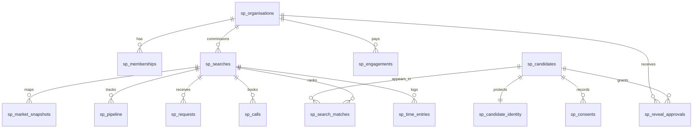

# Proposal: Spearpoint client platform

Data model and screens for approval. No feature code in this change.

Spearpoint maps and researches. Search partners approach, judge and close. The client briefs once, then decides. Hires are above US$150k, staff engineer to board, starting with capital markets.

Users: Client (hiring manager or Head of Talent), Search partner, Admin, Candidate. The candidate never sees client data. Identity is hidden until that candidate approves a specific verified employer.

Build order after approval: client journey (steps 1–3), then the client portal (step 5), then the partner dashboard, then admin. Each stage ships with anonymised sample data and a note of what is not done.

## Recommended stack

| Layer | Pick | Why |
|---|---|---|
| Framework | **Next.js (App Router)** for the new journey only | The live app is one Node serverless function and hand-built HTML. Four roles and the screens below will not stay reviewable in that file. Next.js keeps data access on the server, which this product needs. |
| Database | **Supabase Postgres** | Employer domains, auth users, briefs, introductions and events are already here. A new database would redo that work. |
| Auth | **Supabase Auth** | Work-email rejection, the before-signup hook, and owner/operator metadata already run. A second login system would split the same people. |
| Hosting | **Vercel** | The app, previews and the daily job already run here. The custom domain not following every Git build is a production-branch setting, not a reason to move host. |
| AI | **Vercel AI Gateway, Gemini 2.5 Flash** | Briefs and match reasons already go through the Gateway (`google/gemini-2.5-flash-lite` in the current code). Stay on the Gateway. Use Flash for the client brief and the short “why” lines. Keep temperature at 0 and structured output, as the current calls do. |
| Email | **Resend** | Owner signup alerts already use it. Use the same account for verification and request mail. Do not email candidates from the client product. |
| Calendar | **HubSpot Meetings** | The live link is `https://meetings-eu1.hubspot.com/sam-w/new-client-hiring-briefing-clone`. Booking and the deal belong in one system. |
| Encryption | **TLS, plus Supabase disk encryption, plus application AES-GCM for identity columns** | The browser and the APIs are already HTTPS. Supabase encrypts disks. Names and exact employers must not sit in plaintext as they do today in `sp_public_discoveries`. |

### Trade-off against keeping the current setup

Keeping the single Node handler, Supabase, Vercel and the AI Gateway avoids a replatform. The cost is that every new screen is more logic in `api/index.mjs` and another long HTML file. That is how the current employer workspace, owner dashboard and recruiter desk were built. It is a poor fit for a guided brief, a market map, a pipeline and three extra roles.

The expensive parts to replace would be Supabase (users, `sp_employer_domains`, RLS), Vercel (deploy and cron), the Gateway (prompts and keys) and Resend (just wired). None of those is the bottleneck. The bottleneck is the UI runtime.

### Migration cost

Low if it is additive. Build the new client journey as a Next.js app in this repo, on the same Supabase project and the same Vercel project. Leave the current function serving the existing pilot until the new journey replaces it. Do not rewrite the current employer workspace first.

What moves: new tables below, new routes, and a read of RecruitCRM into an anonymised projection. What stays: auth, domain verification, the Gateway, Resend, the HubSpot link, the RecruitCRM HTTP client.

What it is not: a new cloud, a new database, or a rewrite of partner tools before the client journey works.

## What to reuse, and what to replace

The live app is a Node 22 serverless function on Vercel, Supabase for data and login, the Vercel AI Gateway for Gemini and Perplexity, Resend for owner mail, and a read-only RecruitCRM client. Row Level Security is on, and the server uses the service role.

| Already in the product | Reuse? | Why |
|---|---|---|
| Vercel, Supabase Auth, Postgres, RLS, service role | Reuse | Login, the work-email block and the auth hook are live. |
| `sp_employer_domains` and the before-signup hook | Reuse | This is the start of “real company”. It is not yet “named hiring manager” or “live role”. |
| AI Gateway brief extraction | Reuse | It already turns a mandate into structured fields. The new brief is a wider form, not a new vendor. |
| RecruitCRM read client (`lib/services.mjs`, `lib/recruitcrm.mjs`) | Reuse for partner and admin | Client market view must not call external profile vendors. CRM reads stay server-side. |
| Introduction statuses through `candidate_agreed` | Reuse the rule | Identity is released only after permission. The new model binds that permission to one verified employer and allows withdrawal. |
| `sp_product_events` and Resend | Reuse | Add event names. Do not add a second mail vendor. |
| HubSpot booking URL | Reuse | Deal creation on booking is new. The calendar link is not. |
| `sp_roles`, `sp_role_candidates`, `sp_public_discoveries` | Do not stretch | A role is owned by one user, expires in 180 days, and the pipeline is only new, saved or passed. Discoveries store `person_name` and a URL. That cannot be the client portal. |
| RocketReach, public-web research, licensed-provider stubs | Keep off the client market view | The free view searches Spearpoint’s own database only. |
| Trial GT Canon and GT Standard files | Do not put them back | They were removed because a trial licence is not cleared for this site. |

**Recommendation.** Keep the platform. Add the tables below. Build the new screens in Next.js against the same database. Retire `sp_roles` as the client experience only after the new portal is in use. Do not migrate historical discoveries into the client view. They contain names.

## Data model

New tables use the `sp_` prefix, RLS on, grants to `service_role` only. The API applies the role. Clients never receive a service key.

Identity columns (legal name, email, phone, LinkedIn, exact employer, university) live in `sp_candidate_identity` and are encrypted in the application with AES-GCM before insert. The key is an env var, separate from the Supabase service role. Other tables store buckets and firm types only.

| Table | Key columns | Relations |
|---|---|---|
| `sp_organisations` | id, legal_name, domain, website, verification_status (`pending`, `verified`, `rejected`), verified_by, verified_at, verification_note | One row per employer. Domain matches `sp_employer_domains`. |
| `sp_memberships` | user_id, organisation_id, role (`client_admin`, `hiring_manager`, `talent_lead`) | User belongs to one organisation for this MVP. |
| `sp_searches` | id, organisation_id, created_by, partner_id, status, profile jsonb, engagement_type, fee_percent, engagement_fee, fee_credited, currency, terms_note | Profile holds title, function, seniority, location, remote policy, base and total range, must-haves, nice-to-haves, target firm types, excluded firms, start date. |
| `sp_market_snapshots` | search_id, captured_at, counts jsonb, pay_band, strong_match_count, beyond_database | Counts by firm type, location and seniority. A new row each time the map is refreshed. |
| `sp_candidates` | id, crm_slug, source (`recruitcrm`, `talent_network`, `consented`) | Anonymised projection only: level, years bucket, scope, firm-type history, region, pay band. No name. |
| `sp_candidate_identity` | candidate_id, ciphertext, key_version | One-to-one with `sp_candidates`. Partner and admin only. |
| `sp_consents` | candidate_id, purpose (`in_database`, `anonymised_matching`), granted_at, withdrawn_at, evidence | Withdrawal blocks new matching. It does not delete the audit of past reveals. |
| `sp_search_matches` | search_id, candidate_id, rank, fit, why text, strong | At most 10 shown to the client. `why` is two short lines. |
| `sp_pipeline` | search_id, candidate_id, stage, updated_at, updated_by | Stages: approached, interested, shortlisted, interviewing, offer, hired, withdrawn. |
| `sp_reveal_approvals` | candidate_id, organisation_id, search_id, approved_at, withdrawn_at | Unique on candidate + organisation + search. Withdrawal is a timestamp, not a delete. |
| `sp_outreach_drafts` | search_id, candidate_id, body, status, sent_at, partner_id | Status stays `draft` until the partner marks it sent. The app does not send it. |
| `sp_notes` | search_id, candidate_id, kind, body, author_id | Call, interview, or offer. Not shown to the client as raw notes. |
| `sp_requests` | search_id, type, status, assignee_id, opened_by, completed_at | Types: change brief, add target firm, pause, question. |
| `sp_time_entries` | search_id, partner_id, hours, worked_on | Hours per search, for hours-per-placement. |
| `sp_calls` | search_id, kind (`onboarding`, `weekly`), starts_at, meeting_url, status | Weekly call is every 7 days. Reschedule writes a new row and points at the previous one. |
| `sp_engagements` | organisation_id, search_id, type (`single`, `core`, `enterprise`), fee_percent, monthly_amount, engagement_fee, status | Invoicing is a status and a note. No card charge in this version. |
| `sp_activity` | search_id, actor_id, summary, created_at | Plain English only. No names unless a reveal is active for that client. |
| `sp_audit_log` | actor_id, action (`reveal`, `export`, `verification`, `engagement`), entity, at, meta | Append-only. Clients cannot read other organisations. |

`sp_product_events` stays. Add names: `brief_completed`, `call_booked`, `verification_decided`, `engagement_chosen`, `reveal_approved`, `reveal_withdrawn`. Existing names cover search runs.

### Who can read what

| Role | Can read | Cannot read |
|---|---|---|
| Client | Own organisation, own searches, anonymised matches, pipeline counts, activity written for them, own engagement | Identity table, other clients, drafts, partner notes, time entries |
| Client after a reveal | That candidate’s identity for that search, until withdrawal | Anyone else’s identity |
| Search partner | Assigned searches, identity, drafts, notes, requests, time | Other partners’ searches, admin pricing across the book unless also admin |
| Admin | Verification queue, engagements, reporting totals | Not a shortcut to export identity without an audit row |
| Candidate | Own consent and own reveal approvals | Client names, briefs, and other candidates |

Postgres RLS enforces organisation and assignment. The service role is the only bypass, and it stays on the server. Every reveal and every export inserts `sp_audit_log` in the same action.

Encryption in transit is TLS on Vercel and Supabase. Encryption at rest is Supabase storage plus AES-GCM on `sp_candidate_identity`. Search text, pay ranges and firm types are not encrypted. They are not secret from the client who wrote them. They are secret from other clients, which is an access rule, not a cipher.

## Screens

### Client

| Screen | Purpose | Key elements |
|---|---|---|
| Sign up | Open an account | Work email, password, block free domains. State: verification pending. |
| Guided brief | About five minutes | Title, function, seniority, location, remote policy, base and total range, must-haves, nice-to-haves, target firm types, excluded firms, start date. |
| Search profile | Edit what the AI produced | Same fields, structured, save. |
| Market view | Free look at Spearpoint’s own database | Map: counts by firm type, location, seniority, and a pay range. Up to 10 anonymised matches, ranked, with a short why. If fewer than 3 strong matches, still show the map and say Spearpoint will search beyond the database once the search starts. |
| Anonymised profile | Decide without identifying anyone | Level, years bucket, scope (team size, P&L, asset classes, products), sector history by firm type, region, pay band. No name, employer, photo, LinkedIn, or university. |
| Book a call | Start the commercial step | HubSpot booking from this page. Email and company as query params if the form accepts them. |
| Verification pending | Wait for a real company, named manager, and live role | Status only. No pipeline. |
| Choose engagement | After the call | Single search at 17.5% of first-year base, engagement fee credited. Core from US$3,000 a month or Enterprise from US$8,000, placements at 12.5%. Terms stored on the search. Invoice is manual. |
| Live search | One portal per search | Pipeline counts and profiles (anonymised, or named only after that candidate’s approval). Updated map. Activity in plain English. Weekly call every 7 days, reschedule. Requests: change brief, add target, pause, question. Status changes show up without a refresh dance. |

### Search partner

| Screen | Purpose | Key elements |
|---|---|---|
| My searches | Today’s work | Assigned searches, next action, overdue items. |
| Search workspace | Run one search | Pipeline, outreach drafts, notes, reveal status. Partner sends outreach outside the app. |
| Requests | Clear the client’s queue | Assigned requests, mark complete. |
| Time | Hours per placement | Hours on this search. |

### Admin

| Screen | Purpose | Key elements |
|---|---|---|
| Verification | Before the account leaves “pending” | Company, named hiring manager, live role, approve or reject. |
| Pricing | Terms on the client | Engagement type, percents, monthly amount, engagement fee, status. |
| Reporting | The book | Sign-ups, briefs, calls booked, conversion to paid, live searches, placements, candidate response rate, hours per placement, MRR, churn. |

### Candidate

| Screen | Purpose | Key elements |
|---|---|---|
| Consent | Be in the database, and allow anonymised matching | Two purposes, time, evidence. Withdraw either. |
| Reveal | Approve one verified employer | Employer name, search title, approve or withdraw. Timestamp stored. No other client data. |

## Open decisions

1. **Stack.** Confirm the recommendation above: Next.js for new screens, and keep Supabase, Supabase Auth, Vercel, the AI Gateway with Gemini 2.5 Flash, Resend, and HubSpot Meetings. The alternative is to keep building inside the current Node function. That saves a new app and will slow every later screen.
2. **RecruitCRM sync direction.** Spearpoint’s database is the projection clients see. RecruitCRM is the system of record for candidates, searches and tasks. Which way does a stage change travel? App to CRM, CRM to app, or both? Both needs a rule for conflicts. Until that is chosen, the app should read CRM and not write stages.
3. **Calendar.** Stay on the current HubSpot Meetings link, move to Cal.com, or use Google Calendar? HubSpot is the only one that can also open the deal. Prefill of email and company is untested on the current form.
4. **Fonts.** GT Canon and GT Standard were removed. The trial files are not licensed for this site. Buy the web licences, or keep Georgia and the system sans for the new UI?
5. **Candidate consent surface.** Where does a candidate agree to be in the database and to anonymised matching, and where do they approve or withdraw a named employer? A page on this product, a link in partner email, or both? The current talent-network form is not that flow.
6. **Engagement fee.** Single search says a small engagement fee credited against the 17.5%. The amount is not set.
7. **UAE law.** Which regime applies to candidates and clients in the UAE: onshore PDPL, or the DIFC Data Protection Law? The answer changes the regulator, the transfer rules, and the registration position. This needs a lawyer, not a guess from the office address.
8. **Compliance uncertainties.**
   - Who is the controller for candidate data, Spearpoint or the client, at each stage (database, anonymised match, reveal)?
   - People already in RecruitCRM may not have the new consent on file. They cannot be shown, even anonymised, until that is decided.
   - Anonymised profiles can still identify someone if the career is rare. The product needs a rule for when a profile is too unique to show.
   - Withdrawal of consent must stop new matching. How long the reveal audit is kept, and whether identity ciphertext is deleted, is not decided.
   - UK GDPR and UAE law can both apply to the same search. The proposal does not pick a lead authority.
   - There is no DPIA, no Article 27 representative analysis, and no retention schedule for identity beyond “audit is append-only”.
   - Manual invoicing avoids card data. It does not remove the need for a contract and a privacy notice before a paid search.

## Out of scope until approval

No new tables, screens, or sample data are in this pull request. After approval, stage 1 is the client path from sign-up through the engagement choice, with fictional anonymised profiles only.
